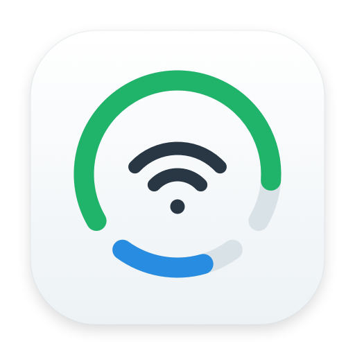
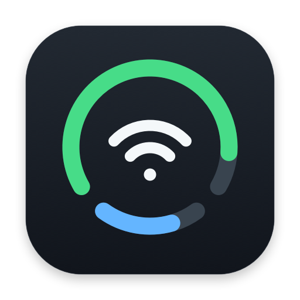

# 应用图标

两版共用同一套原创几何图形，以底色区分用途：浅色用于发布版，深色用于自用版。上方绿色弧线代表电量，中间两道无线电弧线代表 Wi-Fi，下方蓝色短弧代表内存。图标上的比例仅为标识设计，不显示实时数据；菜单栏组合图标继续显示真实状态。

| 发布版 | 自用版 |
| --- | --- |
|  |  |

原始设计以 `scripts/IconArtwork.swift` 中的矢量路径保存，没有使用 Apple 标志、SF Symbols 图片或第三方图形资产。背景、轨道和前景的明度随版本调整，形状与间距保持一致。图标不参与应用的采样或动画，也不需要常驻绘图代码。

## 重新生成

在项目根目录执行：

```sh
./scripts/build-icons.sh
```

使用已有 Swift、AppKit 和 `iconutil`；无需安装图形工具。脚本分别为两种外观直接绘制 16、32、64、128、256、512、1024 像素表示，并生成系统 `.icns` 文件。生成程序、PNG iconset 和编译缓存位于 `build/`，公共预览位于 `docs/assets/`。

- `Resources/AppIcon.icns`：发布版实际打包资源。
- `Resources/AppIcon-Dark.icns`：自用版图标资源，不打进发布版应用。
- `docs/assets/app-icon-light.png`、`app-icon-dark.png`：512 像素预览。

自用版使用深色文件时，将其复制为该工程的 `Resources/AppIcon.icns`，并在其打包配置中指定 `CFBundleIconFile = AppIcon`。给已有应用补图标需要同时复制资源、更新包内配置和重新签名；不用重新编译可执行文件，也不会改变其监测频率或菜单栏绘制逻辑。
